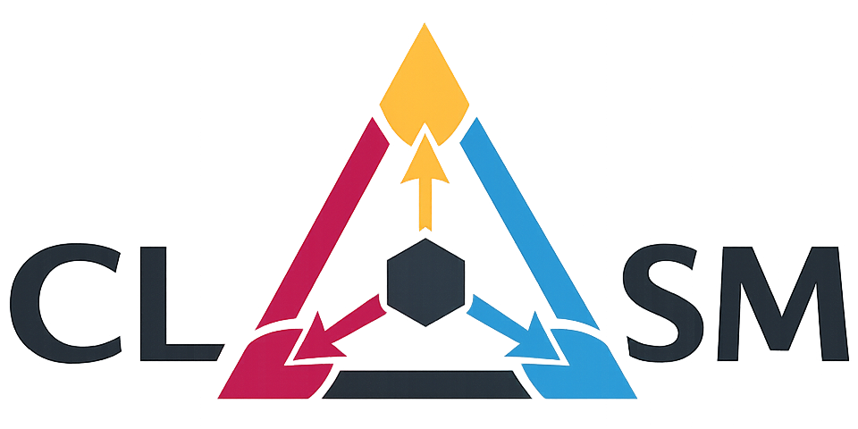

# What competing constraints reveal about representation learning

This repository accompanies the article *What competing constraints reveal about representation learning*, accepted for publication in *Patterns* (Cell Press).

The article examines representation learning through six complementary properties of latent states: predictive sufficiency, minimality, temporal coherence, observation compatibility, nuisance invariance, and structural constraints. These properties provide different ways to characterize what a representation should preserve, discard, or organize. They are neither assumed to be independent nor intended as an exhaustive taxonomy.

A central distinction is made between **desirable representation properties**, **training objectives or architectural choices** intended to encourage them, and **independent diagnostics** used to examine learned representations. Optimizing a particular loss does not establish that the corresponding property holds, and a diagnostic metric captures only selected aspects of that property.

The repository provides reproducible experiments in a controlled synthetic environment, illustrating how different training objectives can favor different representation characteristics. The observed trade-offs are empirical and depend on the experimental setting; they are not claims of universal incompatibility between representation properties.

---

## Representation properties

The article discusses six complementary properties:

| Property | Description |
|---|---|
| 🎯 Predictive sufficiency | Preserve information relevant to specified future targets and horizons |
| ✂️ Minimality | Avoid retaining information unnecessary for the intended task |
| ⏱️ Temporal coherence | Maintain consistency with the dynamics of the modeled process |
| 👁️ Observation compatibility | Support appropriate relationships between latent states and observations |
| 🛡️ Nuisance invariance | Limit sensitivity to irrelevant variability while preserving task-relevant information |
| 🧩 Structural constraints | Favor selected geometric or statistical characteristics of representations |

These properties are conceptually distinct from the losses used during training and from the metrics used during evaluation. Their relationships depend on the task, data distribution, model class, and optimization procedure.

---

## Constrained Latent State Modeling

To investigate how these constraints interact, I developed CLSM (Constrained Latent State Modeling), an experimental framework that combines configurable training objectives with independent representation diagnostics.

<p align="center">
  
</p>

---

## Repository contents

This repository provides:

- model cards examining representative representation-learning approaches through these properties;
- a lightweight PyTorch implementation for controlled experiments;
- a synthetic dynamical environment with physical states, nuisance variables, and multiple observation views;
- reproducible training and evaluation pipelines;
- post-hoc probes and representation-level diagnostics;
- empirical Pareto analyses of selected diagnostic metrics;
- visualization utilities supporting the article and its supplementary material.

The implementation is intended to reproduce and examine the illustrative experiments, not to provide a new general-purpose representation-learning algorithm.

---

## Experimental implementation

The experiments combine selected training objectives that act as surrogates for the representation properties under study. When nuisance invariance is encouraged, a separately optimized categorical nuisance adversary alternates with encoder updates. After initial joint training, an optional adversarial refresh phase uses fixed latent normalization.

Learned representations are evaluated using independent probes and representation-level diagnostics, including:

- multi-step observation prediction;
- physical-state accessibility;
- neighborhood preservation;
- counterfactual consistency;
- nuisance accessibility.

These diagnostics provide complementary evidence but do not establish predictive sufficiency, information-theoretic minimality, or nuisance independence.

A lightweight pareto probe profile supports large configuration sweeps, while a full profile includes additional nonlinear, temporal, CCA, and nuisance diagnostics.

---

## Installation

```bash
git clone https://github.com/gwenole-quellec/clsm.git
cd clsm

python -m venv .venv
source .venv/bin/activate

pip install -r requirements.txt
```

---

## Generate the toy dataset

```bash
python -m toy.environment \
  --metadata toy/metadata.json \
  --output-dir data
```

---

## Run selected configurations

```bash
python -m scripts.run_presets \
  --train-module toy.train \
  --metadata toy/metadata.json \
  --data-dir data
```

Training outputs are written to `runs/`.

---

## Run the constraint sweep

A reproducible six-weight sweep can be run with:

```bash
python -m scripts.constraint_sweep \
  --train-module toy.train \
  --data-dir data \
  --num-configurations 200 \
  --sweep-seed 12345 \
  --model-seeds 0 1 2 3 4 \
  --adversary-steps 15 \
  --epochs 50 \
  --refresh-pretrain-epochs 40 \
  --probe-profile pareto \
  --nuisance-probe-epochs 500 \
  --device cuda
```

The sweep evaluates a finite set of training configurations on the validation split and constructs empirical pairwise Pareto fronts from five representation-level metrics. These fronts characterize the sampled configurations and do not establish universal incompatibilities between representation properties.

---

## Repository structure

- [`clsm/`](clsm/) — shared model and training components
- [`toy/`](toy/) — synthetic environment and training entry point
- [`scripts/`](scripts/) — training, evaluation, sweep, and visualization pipelines
- [`model_cards/`](model_cards/) — conceptual comparisons of representative methods
- [`implementation/`](implementation/) — implementation and reproducibility documentation

---

## Paper

**What competing constraints reveal about representation learning**

Accepted for publication in Patterns (Cell Press), 2026.

The accepted manuscript is available on arXiv: [arXiv:2605.15995](https://arxiv.org/abs/2605.15995)

The recommended citation is:

```bibtex
@article{quellec2027competingconstraints,
  title={What competing constraints reveal about representation learning},
  author={Quellec, Gwenol\'e},
  journal={Patterns},
  note={In press}
}
```

Publication details and DOI will be added when available.

---

## License

This project is released under the MIT License.
